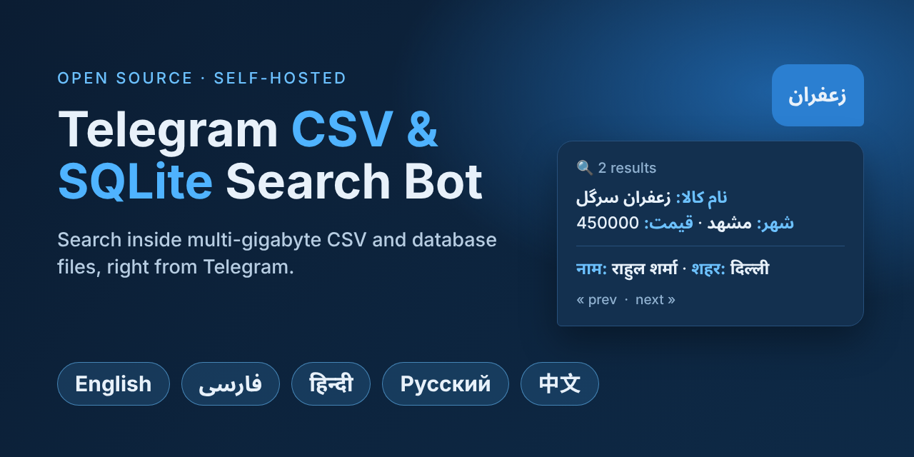

<div align="center">

**[English](README.md)** · **[فارسی](README.fa.md)** · **[हिन्दी](README.hi.md)** · **[Русский](README.ru.md)** · **中文**

</div>

<p align="center"></p>

# Telegram CSV 与 SQLite 搜索机器人

> 免费开源的 **Telegram 机器人，可在 CSV、TSV 和 SQLite（`.db`）文件内搜索**。把文件放进文件夹，就能直接在 Telegram 里搜索，几个 GB 的大文件也没问题。支持**中文、英语、波斯语、印地语和俄语**的全文搜索。可运行于 macOS、Windows、Linux 和 Docker。

关键词：telegram 机器人、CSV 搜索、搜索 CSV 文件、SQLite 搜索、大型 CSV 文件、全文搜索、python-telegram-bot、自托管。

## 功能
- **监控文件夹：** 把 `.csv`、`.tsv`、`.db`、`.sqlite`、`.sqlite3` 文件放进 `data/`。新文件自动建立索引，修改过的文件重新索引，删除的文件从结果中消失。
- **超大文件：** CSV 以流方式读取，即使文件超过 3 GB，内存也只占约 250 MB。600 万行的 CSV 约 2.5 分钟建好索引，大多数搜索在 200 毫秒内完成（SQLite FTS5）。
- **SQLite 数据库：** 可搜索每个 `.db` 文件的所有表（以只读方式打开）。
- **多语言文本：** 数字 `0912`、`۰۹۱۲`、`०९१२` 视为相同；会去掉阿拉伯语变音符号和印地语 nukta；中文可按任意片段搜索（搜“北京”能找到“我在北京工作”）。编码（UTF-8、UTF-16、GBK、Big5、Windows-1251/1256）和分隔符（`, ; | tab`）自动识别。
- **搜索语法：** 多个词（必须全部出现）、词首匹配（3 个字符以上）、`"精确短语"`、翻页按钮。
- **访问控制：** 机器人默认关闭；管理员可直接在聊天中添加或删除用户（`/adduser`、`/deluser`）。
- **安全：** 每个用户的搜索次数与结果数量限制，以及所有搜索的审计日志（`/audit`）。
- **管理员工具：** 在聊天里上传小文件、`/reload`、从索引或原始文件中删除某一行。
- **只需要机器人令牌**（不需要 `API_ID` / `API_HASH`）。在 Telegram 被屏蔽的地区，可使用代理或自建 Bot API 服务器。

## 快速开始

### 1. 创建机器人
1. 在 Telegram 里给 [@BotFather](https://t.me/BotFather) 发送 `/newbot`，复制**令牌**。
2. 从 [@userinfobot](https://t.me/userinfobot) 获取你的数字 id，这就是 `ADMIN_IDS`。

### 2. 安装

**Docker**（任何系统）
```bash
git clone https://github.com/plaipa/telegram-csv-search-bot.git
cd telegram-csv-search-bot
cp .env.example .env        # 填写 BOT_TOKEN 和 ADMIN_IDS
docker compose up -d --build
```

**Python 3.10+**（macOS / Linux）
```bash
cp .env.example .env        # 填写 BOT_TOKEN 和 ADMIN_IDS
python3 -m venv .venv && .venv/bin/pip install -r requirements.txt
.venv/bin/python -m csvbot.check   # 检查设置和 Telegram 连接
.venv/bin/python -m csvbot.bot
```
Windows 请使用 `py -m venv .venv`、`.venv\Scripts\pip` 和 `.venv\Scripts\python`。Linux 服务器可用 `bash deploy/setup.sh` 安装 systemd 服务；macOS 用 `bash deploy/mac.sh`。需要 SQLite 3.43 或更高版本（用 `python -m csvbot.check` 检查；Docker 镜像已包含）。

### 3. 添加文件并搜索
把 CSV / SQLite 文件复制到 `data/`（里面带有一个虚构的 `sample.csv`）。一分钟内管理员会收到“文件已建立索引”的消息。然后给机器人发送任意词即可搜索。

## 设置（`.env`）
| 设置 | 说明 | 默认值 |
|---|---|---|
| `BOT_TOKEN` | 来自 @BotFather 的令牌（必填） | — |
| `ADMIN_IDS` | 管理员的数字 id，用逗号分隔 | — |
| `ALLOWED_USER_IDS` | 额外的允许用户（管理员和通过 `/adduser` 添加的用户之外） | — |
| `DATA_DIR` | 存放文件的文件夹（相对或绝对路径） | `data` |
| `DB_PATH` | 搜索索引文件（自动创建） | `index.db` |
| `SCAN_INTERVAL` | 扫描文件夹的间隔（秒） | `60` |
| `PAGE_SIZE` | 每页结果数 | `5` |
| `SEARCH_LIMIT_HOUR` / `SEARCH_LIMIT_DAY` | 普通用户每小时 / 每天的搜索次数（`0` = 不限） | `60` / `300` |
| `MAX_RESULTS` | 普通用户每次搜索最多可翻看的结果数（`0` = 不限） | `50` |
| `AUDIT_DAYS` | 搜索日志保留天数（`0` = 永久） | `180` |
| `PROXY` | 例如 `socks5://127.0.0.1:10808` | — |
| `TELEGRAM_API_URL` | 自定义 Bot API 服务器 | `https://api.telegram.org` |

修改设置后请运行 `python -m csvbot.check`，它不会输出任何密钥。

## 机器人命令
| 命令 | 作用 | 谁可以用 |
|---|---|---|
| 任意文字、`/search 文字` | 搜索 | 管理员和允许的用户 |
| `/start` | 帮助；没有权限的用户会看到如何联系管理员 | 所有人 |
| `/files` | 已索引文件列表 | 管理员 |
| `/reload` | 立即扫描文件夹 | 管理员 |
| `/users` | 允许用户列表，每人旁边有 ❌ 删除按钮 | 管理员 |
| `/adduser ID`、`/deluser ID` | 按数字 id 添加或删除用户 | 管理员 |
| `/audit [ID]` | 最近的搜索（谁、何时、搜了什么） | 管理员 |
| 结果下方的 🗑 按钮 | 从索引中删除该行，或同时从原始文件中删除（不可恢复） | 管理员 |
| 发送文件 | 添加小于 20 MB 的 CSV/DB | 管理员 |

> **添加用户最简单的方式：** 对方给机器人发送 `/start`，点击 **📩 申请权限**。每位管理员会收到带有 **✅ 同意 / ❌ 拒绝** 按钮的消息，并会通知申请人结果，无需复制 id。

## 更换令牌或 Telegram API 服务器
- **令牌：** 在 BotFather 中发送 `/revoke`（同一个机器人）或 `/newbot`，把新令牌填入 `.env` 的 `BOT_TOKEN`，运行 `python -m csvbot.check`，然后重启机器人。一个令牌只能运行一个实例。
- **API 服务器：** 设置 `TELEGRAM_API_URL=https://your-mirror.example.com`（反向代理、Cloudflare Worker，或自己的 [telegram-bot-api](https://github.com/tdlib/telegram-bot-api) 服务器；后者还能取消 20 MB 的上传限制）。机器人令牌会经过该服务器，所以只使用你自己的或完全信任的服务器。
- **代理 / VPN：** `PROXY=socks5://127.0.0.1:10808`。`python -m csvbot.check` 可以自动发现本地代理。

## 文档
- 完整说明：[English](README.md) · [فارسی](README.fa.md) · [हिन्दी](README.hi.md) · [Русский](README.ru.md)
- 在自己的电脑上运行：[docs/local.md](docs/local.md) · 免费的 Oracle Cloud 服务器：[docs/oracle-cloud.md](docs/oracle-cloud.md)
- GitHub 仓库设置：[docs/github-seo.md](docs/github-seo.md)
- 测试：`python -m unittest discover -s tests -v`

## 负责任的使用、许可证与免责声明
本机器人是通用的文件搜索工具。它不附带任何数据，不会向任何地方发送数据，也不收集任何内容；每个安装都是独立的，只读取**你自己**放进 `data/` 的文件。你需要对自己的数据负责，并遵守当地法律（包括个人信息保护法）和 Telegram 的条款。请勿用它搜索未经本人同意收集或泄露的个人信息。不要把 `.env` 和 `data/` 提交到 git。

采用 [MIT 许可证](LICENSE)，按“现状”提供，不附带任何担保。
